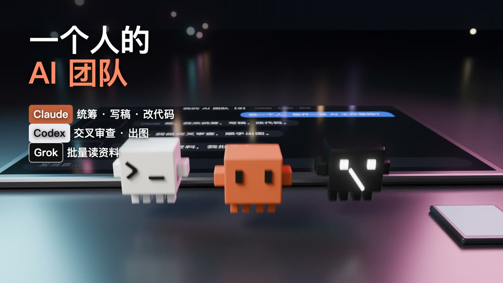

# 一个人的 AI 团队 · 用代码做的 3D 宣传片

一个人 + 三个 AI（Claude、Codex、Grok），做了一条 99 秒的 3D 宣传片。没打开过 Blender 界面，没手调一个关键帧：时间表、界面、镜头、配乐全是代码写的，Blender 在后台渲染。

| | |
|---|---|
| 成片 | [一个人的AI团队.mp4](../../releases/latest)（1920×1080，30fps，99.3 秒，116 BPM） |
| 代码 | 1,840 行（`film/`，构建时现数） |
| 画面 | 2,979 帧；屏幕上的界面是 47,665 张网页截图贴上去的 |
| 手调关键帧 | 0 个 |



## 怎么做出来的

所有动作、镜头、字幕、音效都读**同一份时间表**，按「第几小节第几拍」写，改节奏只改一个数。

| 环节 | 文件 | 做法 |
|---|---|---|
| 时间表（唯一真值） | `film/timeline.py` → `timeline.json` | 网页、3D、配乐三处共用 |
| 界面 | `film/ui/*.html` + `shoot.mjs` | 每个界面一个 HTML，无头浏览器逐帧截图，贴到 3D 屏幕上；字幕层透明叠最上面 |
| 3D | `film/scene.py` | Blender 后台运行，Python 搭桌面、角色、灯光；每一帧的位置由时间函数算出写入 |
| 配乐 | `film/score.py` | 鼓、贝斯、铃铛、木琴全部 numpy 合成；角色落一格就响一个音 |
| 渲染 | `film/farm.sh` | 多台电脑从同一个队列领帧段，渲完拉回 |
| 验收 + 合成 | `film/verify_compose.py` | 逐帧核对（序号连续、能解码、不是粉屏）通过才合成 |

## 自己跑一遍

把下面这句话发给你的 coding agent（Claude Code、Codex 都行）：

```
阅读并执行 https://github.com/limin940603/one-person-ai-team/blob/main/SKILL.md
```

它会照 [SKILL.md](SKILL.md) 装环境、出 10 秒小样、再渲全片。人工操作也按那份文件走。

## 想做自己的片子

[prompts/一个人的AI团队-提示词.md](prompts/一个人的AI团队-提示词.md)：9 条提示词按顺序发给 Claude Code，【】里换成你的题材。文末有踩过的坑。

## 用到的东西（都免费）

- [lemo-opuscar](https://github.com/lemomo-ai/lemo-opuscar)（MIT）：本片放在它的 `films/` 下运行，复用它的浏览器截图和音效底层。`patches/` 里有一个可选的画质补丁（成片 crf 可调、无损中间片段）。
- Blender 5.2、Playwright、Python（numpy、soundfile、Pillow）、ffmpeg。

角色形象：Claude 用的是官方 Clawd 的体素化版本；Codex、Grok 是自己设计的形象，和官方无关。

## 许可

MIT。作者：克劳德队长。
